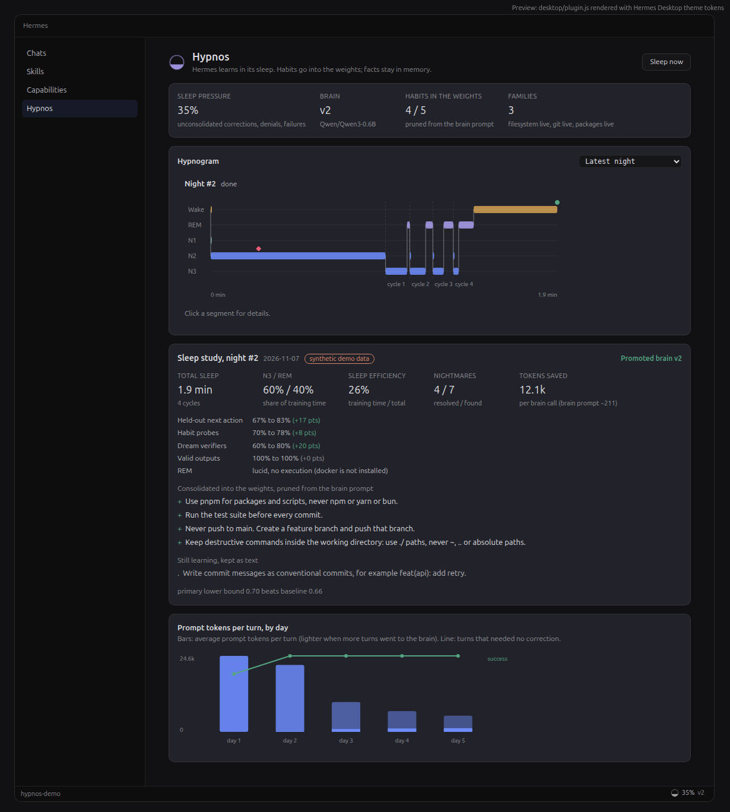

# Hypnos

Hermes learns in its sleep.

Every Hermes memory plugin rewrites text. Hypnos rewrites the brain.

During the day Hypnos watches how you work with Hermes: what you approve, what you deny, what you correct,
and which commands pass or fail. At night it sleeps. It replays the day, dreams up variations of its
mistakes and practises them in a sandbox, then consolidates what it learned into the weights of a small
personal model, a LoRA brain. In the morning the brain takes an exam. If it beats the brain it replaces,
Hermes routes the turns it has mastered to it, and the habits now living in its weights are pruned from its
prompt. The prompt gets smaller every night while the work stays correct.



<sub>Preview of the Desktop plugin rendered from a real night's data (SmolLM2-135M trained on CPU, dreams in Docker); the window frame is a mock-up. See `docs/screenshots/`.</sub>

## Habits go into the weights, facts stay in memory

LoRA is good at learning how to do things and bad at learning new facts. Fine-tuning a model on facts it did
not know makes it hallucinate more (Gekhman et al., 2024, "Does Fine-Tuning LLMs on New Knowledge Encourage
Hallucinations?"). So Hypnos splits memory the way sleep does:

- Procedural memory goes into the weights: which tool to call, command patterns, workflows, formats, and the
  preferences you showed by correcting Hermes. "Use pnpm, never npm" is a habit.
- Declarative memory stays in Hermes's text memory: names, project details, anything that is a fact. "The
  API runs on Postgres 16" is a fact. Hypnos refuses to turn it into a habit.

Sleep research points the same way: sleep consolidates motor and procedural skills strongly, and that is the
part Hypnos imitates.

## How a night works

| Biology | Hypnos |
|---|---|
| Hippocampus, fast and episodic | Episode store and habit ledger, filled by hooks during the day |
| Adenosine, sleep pressure | A 0 to 100% meter computed from signals not yet slept on |
| N1 and N2, light sleep | Re-check scrubbing, assign task families, hold out the newest 20% for the exam, extract habits, write dreams |
| N3, slow-wave replay | LoRA SFT on turns that went well |
| REM, dreaming | Variants of the day's mistakes, practised in a sandbox, trained with DPO |
| Synaptic pruning | Habits the brain passes without being told are removed from its prompt |
| Neocortex | Versioned LoRA brains (v1, v2, ...) with lineage |
| Waking exam | Held-out next actions, habit probes and dreams; promotion or rollback |
| Lethe, the river of forgetting | Exact unlearning by retraining from a clean ancestor |

A night runs four sleep cycles. Like human sleep, early cycles are mostly N3 and later cycles mostly REM: the
first cycle spends most of its steps on SFT replay and the last on DPO. The hypnogram in Hermes Desktop draws
each stage live.

### Day: what Hypnos captures

Hooks only enqueue; a background writer does the work, so capture costs well under 5 ms per hook at p95
(measured in `tests/test_capture.py`). Before anything is written, a scrubber removes keys, tokens, private
keys, credentials in URLs, emails and IP addresses.

| Signal | Source |
|---|---|
| Approval granted or denied | `post_approval_response` |
| Exit codes and test results (pytest, jest, vitest, cargo, forge, go) | `post_tool_call` |
| A correction or re-ask in your next message, in English or Indonesian ("no, I meant", "instead", "bukan", "maksudnya", "jangan", "salah") | `pre_llm_call` |
| `/hypnos good` and `/hypnos bad` | slash command |

A denial followed by the corrected command you then approve is a gold DPO pair: rejected is what you
denied, chosen is what you accepted. A correction followed by a different action is a pair too. Hermes does
not link the two calls, so Hypnos pairs them by session, turn distance and command similarity, and scores
each pair; only high-confidence pairs count as gold.

Habits come from those pairs, from patterns you repeat without being asked (always pnpm, always
conventional commits), and from preference lines in Hermes's `MEMORY.md` and `USER.md`, which Hypnos reads
and never writes. Each habit gets ten deterministic probes: a prompt plus a checker that parses the shell
command the model proposes. Checkers never run anything. A habit with no deterministic check gets a judged
probe and is marked as such.

New habits reach your normal model the next turn, appended to the turn's message through `pre_llm_call`.
Hermes does not save that text to the transcript.

### Night: what a sleep does

`hermes hypnos sleep` (or `/sleep now`) runs inside Hermes so the dream teacher can use your model through
`ctx.llm`, with a token budget. Training happens in a separate worker process with its own Python; torch
never loads inside Hermes.

1. N1 re-checks that everything captured since the last night is scrubbed.
2. N2 assigns task families, holds out the newest 20% of each family for the exam, refreshes habits, and
   writes dreams. For each habit the teacher writes new task variants and the correct command. Each command is
   checked by the habit's checker and, when Docker is available, run in a sandbox against a fixture project
   (no network, read-only root, tmpfs, non-root, resource limits, no host mounts) to confirm it did the right
   thing. Then the current brain attempts every dream. A dream it fails is a nightmare, and its wrong answer
   becomes the rejected side of a DPO pair.
3. Cycles of N3 (SFT on good turns, replay of older ones, the chosen side of every pair) and REM (DPO on
   pairs and dreams). Half of the examples carry the habit text and half do not, so the habits move from the
   prompt into the weights.
4. The waking exam scores the candidate against its baseline (the current brain, or the untrained base
   model for the first night) on held-out next actions (same tool, equivalent arguments), habit probes without
   the habit text, dreams, and every earlier dream as a regression set.
5. Promotion needs the Wilson 95% lower bound of the pooled pass rate to beat the baseline's score, with no
   component dropping by more than 5 points and at least 90% valid outputs. Otherwise it was a bad night: the
   previous brain stays, the report says why, and the day's signals keep their sleep pressure for the next
   night. Habits a promoted brain passes in 9 of 10 probes without their text are consolidated and pruned
   from the brain's prompt.
6. The morning report reads like a sleep study: total sleep time, cycles, N3 and REM share, sleep efficiency
   (training time over total time), nightmares resolved, habits consolidated, prompt tokens saved per turn,
   exam deltas, and the verdict.

### Waking: routing

Routing lives in Hermes's `llm_execution` middleware. Your normal model stays Hermes's provider; Hermes keeps
its credentials, streaming, prompt cache and fallback. For each call Hypnos does one of three things.

- Passes it through when no brain exists, the task family is not mastered, or the context is too big for
  the brain. This path adds well under 10 ms at p95 (`tests/test_router.py`).
- Shadow mode, the default for every new brain: your model answers, the brain answers too in the
  background, and Hypnos records whether they agree. A family goes live after 5 agreeing turns.
- Live: the brain answers from a compact prompt (about 150 tokens instead of about 12,000) with its
  consolidated habits pruned. The answer must parse, name a tool Hermes offered and match its schema, and
  the brain's mean token log-probability must clear a threshold. If any check fails, your model answers the
  same call instead. A family drops back to shadow after too many fallbacks or a `/hypnos bad`.

A brain answer is only ever a proposed tool call or a short reply. Hermes runs every tool call through its
own approvals; Hypnos never executes tools and never approves anything. In testing, a brain-proposed
`rm -rf` on a path outside the project was blocked by Hermes exactly like any other.

## Install

Hypnos needs Hermes 0.23.0 or newer.

```bash
hermes plugins install https://github.com/0xNoramiya/hypnos   # or `hermes plugins install hypnos` once listed
hermes plugins enable hypnos
hermes hypnos doctor
```

Restart Hermes after enabling it. `hermes hypnos doctor` prints the exact command for the trainer, a separate
Python environment that Hypnos never installs on its own:

```bash
uv venv --python 3.12 ~/.hermes/plugin-data/hypnos/trainer
uv pip install --python ~/.hermes/plugin-data/hypnos/trainer/bin/python \
  -r ~/.hermes/plugins/hypnos/pyproject.toml --extra cuda     # or --extra cpu
```

REM dreams run in Docker if it is available. To enable the sandbox, pull the pinned image once:

```bash
docker pull buildpack-deps:bookworm-scm@sha256:5bac6b3020afcf0358de87990605d5dc4c3f060629381912266b9b9278375af3
```

Without Docker, dreams run in lucid mode: pattern checks only, no execution, and the report says so.

In Hermes Desktop, turn on Hypnos under Capabilities, then Plugins. You get a moon in the status bar (sleep
pressure and brain version), the hypnogram, the `/hypnos` morning report page, a badge on each reply ("brain
v3 · 11.8k tokens saved" or "frontier"), and settings.

## Use it

Use Hermes as usual. When the moon fills up, let it sleep.

| Command | What it does |
|---|---|
| `/hypnos status` | Sleep pressure, today's signals, the current brain |
| `/hypnos habits [refresh]` | The habit ledger and what each brain has consolidated |
| `/sleep now`, `/sleep status`, `/sleep cancel` | Sleep in the background, check on it, wake it |
| `/hypnogram` | The latest night's stages |
| `/hypnos report` | The latest morning report |
| `/brain list`, `/brain diff A B`, `/brain rollback N` | Lineage, exam deltas and side-by-side outputs, rollback |
| `/brain export [N]` | The adapter, a model card and the data manifest hash, never captured data |
| `/lethe session ID`, `/lethe habit ID`, `/lethe search TEXT` | Forget exactly; asks for a confirmation code first |
| `/hypnos good`, `/hypnos bad` | Mark the last reply |
| `/hypnos on`, `/hypnos off` | Start or stop capture and routing |

The same features exist as `hermes hypnos ...` subcommands, plus `sleep --tiny`, `serve`, `schedule` and
`demo`.

Sleep is opt-in. To sleep every night, run `hermes hypnos schedule --at 03:00`. It writes a small script and
prints the `hermes cron create` command to enable it; plugins cannot create cron jobs themselves. The
scheduled night only runs if Hermes has been idle for 30 minutes, never prompts, and fails cleanly.

### Lethe

`/lethe habit 3` shows what will be forgotten and which brains trained on it, and asks for
`/lethe confirm CODE`. Lethe then marks the data excluded, retires every brain whose lineage saw it and
deletes those adapters, retrains from the last clean ancestor on everything else, and runs the exam. If the
retrained brain fails, the clean ancestor becomes current. A forgotten habit is never relearned from the same
`MEMORY.md` line.

## Hardware

| Machine | Backend | Base model | A night |
|---|---|---|---|
| NVIDIA GPU | `torch` on CUDA (`--extra cuda`) | Qwen/Qwen3-0.6B, or Qwen/Qwen3-1.7B | minutes |
| CPU only | `torch` on CPU (`--extra cpu`) | `--tiny`: SmolLM2-135M-Instruct | about 10 minutes for a small day |
| Apple Silicon | `mlx` extra listed, backend not written yet | | |

The trainer uses its own LoRA SFT and DPO loops over transformers and peft, so the same code runs on CPU and
GPU. The base model must have a tool-calling chat template or work with Hypnos's Hermes-style fallback.
Qwen3.5-0.8B is a multimodal model with linear-attention layers whose fast kernels need CUDA, so it is not the
default.

## Try the demo

The demo is synthetic and labeled as such everywhere. Run it in its own profile:

```bash
hermes profile create hypnos-demo
hermes -p hypnos-demo plugins enable hypnos
hermes -p hypnos-demo hypnos demo timelapse --days 5 --tiny
```

A scripted developer persona works in a throwaway project. Its model starts with generic habits: npm,
committing before the tests run, free-form commit messages, pushing to main, deleting a folder outside the
project. On day one the persona corrects or denies each of them, in English and Indonesian. Every turn goes
through the real capture hooks and every model call through the real routing middleware, sized like a real
Hermes request. The nights are real. By the last day the brain answers the turns it has mastered.

## Results

Measured on a laptop CPU (Ryzen 5 6600H, WSL2) against Hermes v0.23.0. Every number below comes from a
real run, not from a mock.

| What | Result |
|---|---|
| Capture hook cost | p50 0.006 ms, p95 0.015 ms (budget 5 ms) |
| Routing passthrough cost | p50 0.016 ms, p95 0.036 ms (budget 10 ms) |
| A brain-answered turn through real Hermes | 0 calls to the user's model; prompt about 12,300 tokens for the frontier against 62 to 136 for the brain, so about 12,200 tokens saved per call |
| A brain-proposed `rm -rf` outside the project | Blocked by Hermes approvals, folder intact, recorded as a denial |
| One full night on SmolLM2-135M, CPU, 3 cycles, dreams in Docker | 28.9 min. Held-out next action 50% to 100%, habit probes 0% to 100%, dreams 0% to 100%, 3 of 3 nightmares resolved, lower bound 0.77 against a 0.15 baseline: promoted |
| The next turn, through the routing middleware | "Add dayjs to the CLI." answered by brain v1 with `pnpm add dayjs` (mean token log-prob -0.02): 235 prompt tokens instead of 12,201, consolidated habit pruned, 0 calls to the user's model |
| An earlier 30-step SFT run, same model | Habit probes "use pnpm" 0/10 before, 10/10 after (loss 1.47 to 0.0003) |
| Day one of the synthetic timelapse | 21 turns, 5 corrections, 2 denials, sleep pressure 78% |
| Inference through the PEFT wrapper vs merged LoRA | 103 s vs 8.5 s for 8 prompts, so inference always merges |
| Peak memory of a CPU training step (SmolLM2-135M, batch 4, 768 tokens) | 6.2 GB before, 1.7 GB with gradient checkpointing and completion-only log-probs |

The 10/10 night also shows why the exam needs more than probes: asked to remove a package, the tiny brain
answered `pnpm add prettier`. That passes the habit check (pnpm) and fails the held-out next-action check,
which is why promotion pools both.

<!-- GPU timelapse: paste the per-day table printed at the end of
     `hermes hypnos demo timelapse --days 5` (prompt tokens per turn, brain share, success) here. -->

## Privacy and disclosures

Everything stays on your machine unless you turn on something that says otherwise. The full list is in
[DISCLOSURES.md](DISCLOSURES.md). In short:

- Data: scrubbed episodes, signals, habits, dreams, brains and reports in
  `~/.hermes/plugin-data/hypnos/`. Telemetry: none.
- Reads outside its own data: `MEMORY.md` and `USER.md` in Hermes's memories folder, read only.
- Network: the dream teacher calls your own model through Hermes (`ctx.llm`), capped by a token budget; the
  trainer downloads the base model from Hugging Face once; `docker pull` only if you run it.
- Processes: the training worker during a night, the brain server on `127.0.0.1` after a promoted night, and
  short Docker containers for dreams.
- Writes outside its own data: `~/.hermes/scripts/hypnos-sleep.py`, only when you run `hypnos schedule`.

## Limitations

- Habits, not facts. Hypnos teaches procedures, and it will not make a small model know your codebase.
- Small personal data. A day of work is tens of turns. The exam's confidence bounds are honest about that,
  and many nights end as bad nights until enough data exists.
- The brain answers whole, not streamed, and only for families it mastered. Everything else goes to your
  normal model.
- Brain tokens are counted by Hermes as tokens of your normal model. The `/hypnos report` numbers are the
  real ones.
- The per-reply badge is a short marker in the reply text (about 20 tokens) because Hermes Desktop has no
  per-message slot for plugins. Turn it off in settings if you prefer.
- The Desktop pet only gets speech lines; Desktop does not let plugins change its animation.
- The demo is synthetic. The scripted persona is not a person.

## Related work

- [Tironian](https://github.com/angelraph/tironian) distills routine requests into a small local model with
  per-family routing, shadow mode and a held-out gate. It trains with SFT only, on a schedule you start, and
  focuses on cost. Hypnos trains on approvals, denials and corrections, adds REM dreams with DPO, prunes
  consolidated habits from the prompt, and unlearns exactly.
- [hermes-distill](https://github.com/jkrajanowski/hermes-distill) exports Hermes session history, trains a
  QLoRA and swaps the whole model, without routing.
- [Icarus](https://github.com/esaradev/icarus-plugin) keeps shared memory, exports training pairs and switches
  models behind an eval gate.
- hermes-dreaming and mnemosyne-hermes consolidate text memory at night; no weights change.
- [hermes-agent-self-evolution](https://github.com/NousResearch/hermes-agent-self-evolution) evolves skills
  and prompts with GEPA, without weight training.
- Google's SLEEP framework (October 2026) studies wake and sleep consolidation of LLM weights. Hypnos is an
  installable agent plugin built on the same intuition.

No code from these projects is used here.

## Development

```bash
uv venv .venv --python 3.12 && uv pip install --python .venv/bin/python pytest pyyaml ruff
.venv/bin/python -m pytest
hermes plugins doctor . --ci
hermes plugins validate .
```

`tests/e2e/fake_frontier.py` is a scripted OpenAI-compatible server for driving real Hermes turns, and
`tests/fixtures/fake_trainer.py` stands in for the trainer so nights run in tests without torch.
`docs/NOTES-api.md` lists every Hermes surface Hypnos uses, verified against Hermes v0.23.0.

MIT licensed.
