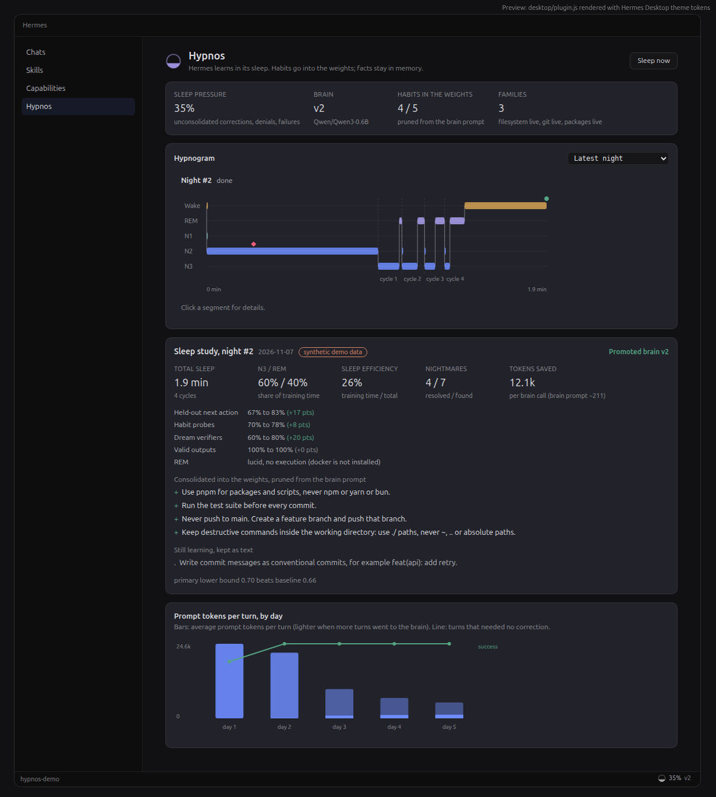
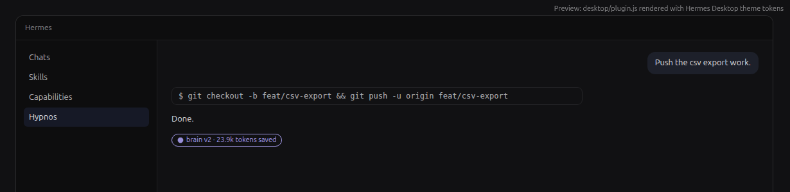

<!-- PR title: feat(plugin-catalog): add hypnos plugin -->

## What does this PR do?

Adds one file, `plugin-catalog/hypnos.yaml`, listing [Hypnos](https://github.com/0xNoramiya/hypnos) (MIT),
pinned to `<SHA>`. I own the repository.

Hypnos teaches Hermes your habits while it sleeps. During the day it records what you approve, deny and
correct, and which commands pass or fail. At night it replays the day, dreams up variations of its mistakes
and checks them in a Docker sandbox, and trains a small LoRA brain with SFT and DPO. In the morning the brain
takes an exam (held-out next actions, habit probes, dreams) and is promoted only if its 95% lower bound beats
the brain it would replace. Hermes then routes the task families the brain has mastered to it, with the
habits it learned pruned from its prompt. Only procedural habits go into the weights; facts stay in Hermes's
text memory. `/lethe` forgets a session or a habit exactly, by retraining from a clean ancestor.

Trailer (88 s): https://x.com/acetaminofenol/status/2119120790495039622

Not derived from any listed entry. The closest listed plugins are `icarus` (trains replacement models from
session history) and `hermes-dreaming` (consolidates text memory at night). Hypnos trains on approvals,
denials and corrections, adds DPO on dreamed variants of mistakes, gates every brain with an exam, prunes
learned habits from the prompt, and unlearns exactly.

### Hermes surfaces used

- Hooks: `pre_llm_call` (capture, correction detection, habit context), `post_tool_call`,
  `post_approval_response`, `post_llm_call`, `on_session_end`, `on_session_finalize`, `post_compaction`,
  `on_session_delete`, `transform_llm_output` (the Desktop reply badge; Desktop only, with a setting to turn
  it off).
- Middleware: `llm_execution`, for routing. The user's model stays Hermes's provider; a brain answer is a
  proposed tool call or a short reply, and its tool calls go through Hermes approvals like any other.
- Slash commands `/hypnos`, `/sleep`, `/hypnogram`, `/brain`, `/lethe`, and the CLI `hermes hypnos ...`.
- `ctx.llm` with its own auxiliary task `hypnos_teacher`; `ctx.get_config` / `set_config`; `config_schema`.
- `plugins.plugin_storage`, `agent.secret_scope` (no secrets declared today), `hermes_cli.plugin_events`,
  `hermes_cli.config.load_config_readonly`, `hermes_cli.setup.prompt_yes_no`. Every import is on the public
  plugin API list.
- Dashboard backend routes (`dashboard/plugin_api.py`) and a Desktop plugin (`desktop/plugin.js`, SDK only,
  no build step): status bar, route, sidebar nav, palette, session row, transcript directive, settings page
  and pet lines.

### Disclosures (rule 13)

- **Data it stores:** scrubbed copies of turns, signals, habits, dreams, brains (LoRA adapters) and reports in
  `plugin-data/hypnos/` of the active profile. Keys, tokens, credentials in URLs, emails, IPs and
  high-entropy strings are scrubbed before anything is written, and each night re-checks. Deleting a Hermes
  session deletes its Hypnos data.
- **Reads outside its data:** `MEMORY.md` and `USER.md` in Hermes's memories folder, read only, for
  preference lines that describe habits.
- **Writes outside its data:** `scripts/hypnos-sleep.py` in the profile, only when the user runs
  `hermes hypnos schedule`. Cron jobs are never created by the plugin; it prints the command.
- **Network:** the dream teacher calls the user's own model through `ctx.llm`, capped by a per-night token
  budget (never, with `teacher: scripted`). The trainer downloads the chosen base model from Hugging Face
  once. `hf upload` runs only with `--push-to-hub`. `docker pull` runs only if the user runs it. The brain
  server listens on `127.0.0.1` only. Telemetry: none.
- **Background processes:** a training worker during a night (a separate Python with a minimal environment
  and no Hermes or provider credentials), and a brain server on `127.0.0.1:8765` after a promoted night
  (`auto_start_brain_server` turns it off). `/sleep now` and Desktop's Sleep button run the night as a
  background `hermes hypnos sleep`.
- **Shell and Docker:** runs `docker run` for REM dreams with no network, all capabilities dropped, a
  read-only root, tmpfs, a non-root user, CPU, memory, process and time limits, and no host mounts. The image
  is `buildpack-deps:bookworm-scm`, pinned by digest. Also runs the trainer Python and `hermes` itself.
- **Credentials:** none stored, none read. No `requires_env`; the teacher uses Hermes's routes.

### Approvals and unattended runs (rule 12)

Hypnos never approves, denies or skips an approval. A brain answer reaches Hermes as an ordinary proposed tool
call; in testing, a brain-proposed `rm -rf` outside the project was blocked by Hermes approvals. Commands in
dreams come from the teacher and the brain and run only inside the sandbox container, never on the host and
never as Hermes tool calls. The background night has no tools. Scheduled nights never prompt and fail cleanly
under cron and the gateway.

### Results

A five-day synthetic timelapse (a scripted developer persona) with Qwen3-0.6B on one A40: prompt tokens per
turn went from 24,636 on day 1 to 5,256 on day 5 (−79%), the brain answered 81% of day-5 turns, and task
success went from 76% on day 1 to 100% on days 2 to 5. Two of the four nights were rejected by the exam and
the previous brain stayed. Each night took 1.3 to 2.4 minutes. The same run on a laptop CPU with
SmolLM2-135M: 24,636 to 18,711 prompt tokens per turn, 25% answered by the brain. Details are in the README
under Results.

## Related Issue

None: a new catalog entry.

## Type of Change

- [ ] 🐛 Bug fix (non-breaking change that fixes an issue)
- [x] ✨ New feature (non-breaking change that adds functionality)
- [ ] 🔒 Security fix
- [ ] 📝 Documentation update
- [ ] ✅ Tests (adding or improving test coverage)
- [ ] ♻️ Refactor (no behavior change)
- [ ] 🎯 New skill (bundled or hub)

## Changes Made

- `plugin-catalog/hypnos.yaml`: new entry. `tier: community`, `category: models`,
  `requires_hermes: ">=0.23.0"` (the same floor as `plugin.yaml`), `version: "0.1.0"` (matches
  `plugin.yaml`), capabilities exactly as registered (9 hooks, `llm_execution` middleware, no tools, no env),
  banner and screenshots pinned to the same commit.

## How to Test

1. At the pinned commit: `hermes plugins validate . --install-deps` prints "Validation passed." (security scan
   safe, desktop surface clean, no core override, declared hooks and middleware match).
2. Install and check: `hermes plugins install https://github.com/0xNoramiya/hypnos`, then
   `hermes plugins enable hypnos`, restart Hermes, and `hermes hypnos doctor`. It prints the trainer setup
   command (`--extra cuda` or `--extra cpu`).
3. Synthetic demo in its own profile:
   `hermes profile create hypnos-demo && hermes -p hypnos-demo plugins enable hypnos`, then
   `hermes -p hypnos-demo hypnos demo timelapse --days 5` (GPU, about 15 minutes) or add `--tiny` (CPU, about
   2.5 hours). `hermes -p hypnos-demo hypnos report` shows the last morning report.
4. Plugin tests: `uv run --group dev pytest -q` in the repo: 230 passed, 1 skipped (the opt-in real-training
   test, run with `HYPNOS_E2E_TRAINER=<trainer python>`; it passes in about 10 minutes on CPU).

## Checklist

### Code

- [x] I've read the [Contributing Guide](https://github.com/NousResearch/hermes-agent/blob/main/CONTRIBUTING.md) and the [catalog admission rules](https://github.com/NousResearch/hermes-agent/blob/main/plugin-catalog/README.md)
- [x] My commit messages follow [Conventional Commits](https://www.conventionalcommits.org/) (`feat(plugin-catalog): add hypnos plugin`)
- [x] I searched for [existing PRs](https://github.com/NousResearch/hermes-agent/pulls) to make sure this isn't a duplicate
- [x] My PR contains **only** changes related to this feature (one new file)
- [x] I've run `pytest tests/ -q` and all tests pass: N/A, no Hermes code changes; catalog CI validates the entry
- [x] `python scripts/check` passes: N/A, no Hermes code changes
- [x] I've added tests for my changes: the plugin has 230 tests in its own repository
- [x] I've tested on my platform: Ubuntu under WSL2 (CPU) and an Ubuntu 24.04 GPU pod (A40), Hermes v0.23.0; macOS not tested

### Documentation & Housekeeping

- [x] I've updated relevant documentation: the plugin's README, DISCLOSURES.md and docs
- [x] I've updated `cli-config.yaml.example` if I added/changed config keys: N/A
- [x] I've updated `CONTRIBUTING.md` or `AGENTS.md` if I changed architecture or workflows: N/A
- [x] I've considered cross-platform impact: pure Python plugin, Windows-safe locking; Docker optional
- [x] I've updated tool descriptions/schemas if I changed tool behavior: N/A, no tools

## Screenshots / Logs

The `/hypnos` page after the five-day GPU run (hypnogram, sleep study, exam deltas, habits in the weights,
prompt tokens per turn by day), and a brain-answered reply with its badge:

These render the real `desktop/plugin.js` components with the run's real REST data and Hermes Desktop's
theme tokens; the window frame around them is a mock-up.

<!-- Optional: replace or add captures from Hermes Desktop itself (the hypnos-demo profile holds the GPU run):
     the /hypnos page, a hypnogram with a REM segment selected, a reply badge with the status bar moon, and
     Settings > Plugins > Hypnos. Save them in docs/screenshots/, commit, and pin their URLs like the ones above. -->

🤖 Generated with [Claude Code](https://claude.com/claude-code)
